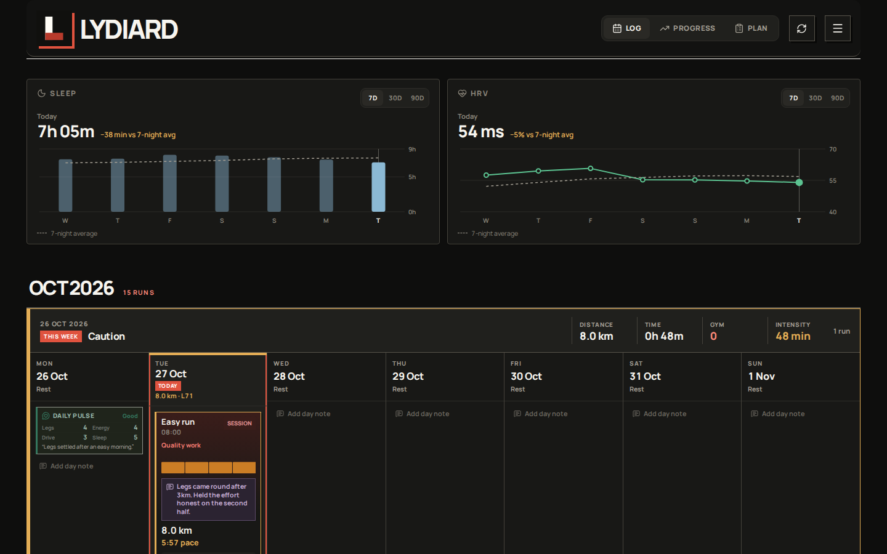
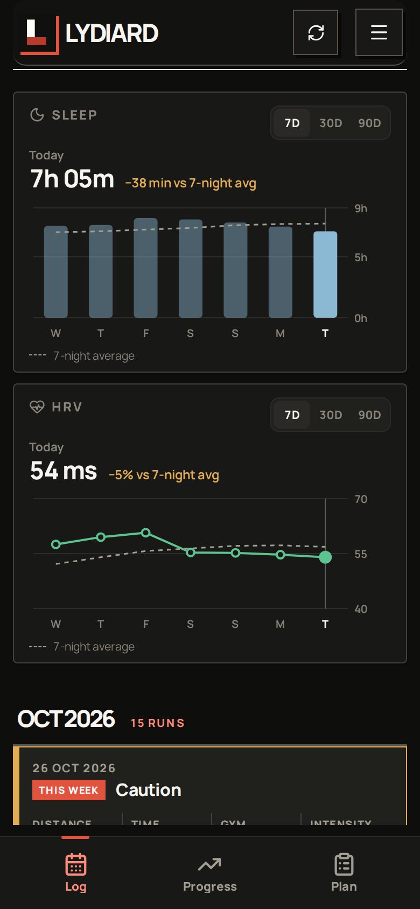
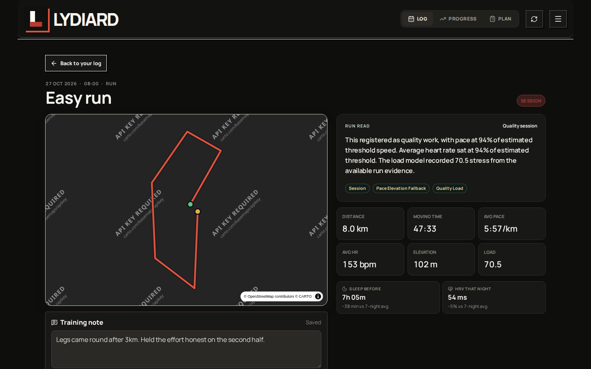
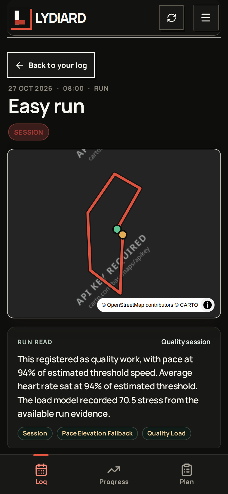
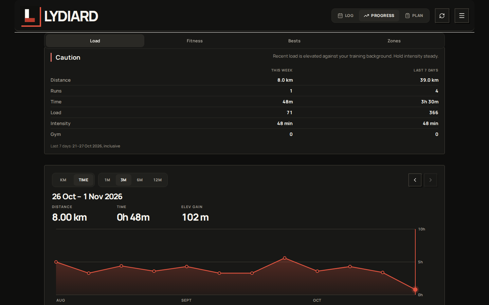
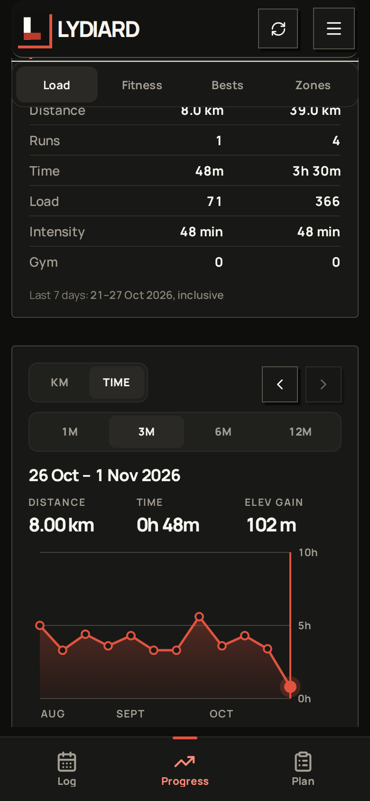
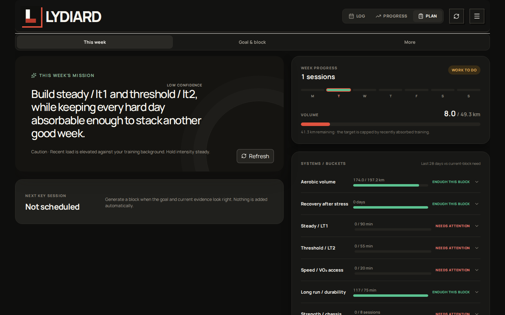
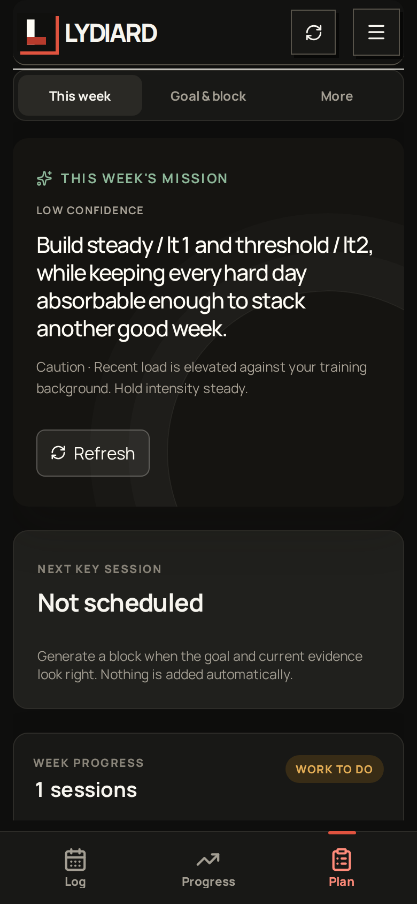

# Lydiard

A running diary with a coach behind it: a Strava-style training log with direct activity notes,
all-time and seasonal best efforts, clear weekly progression, and an editable future plan. The
deeper physiology and load models remain available without dominating the daily workflow. Runs free
on Cloudflare with no always-on local machine.

The code is MIT-licensed and meant to be deployed by anyone. Each deployment keeps its own data:
training history lives in your own Cloudflare D1 instance, and the read API sits behind a site
password you set. Nothing personal is in this repository — see [Your own data](#your-own-data).

## Screenshots

Every shot below is fixture data, not real training. The same three destinations work at both sizes.

| | Desktop | Mobile |
| --- | --- | --- |
| **Log** — the week you are in, run by run |  |  |
| **A run** — route, read, splits and your note |  |  |
| **Progress** — weekly totals, zones and bests |  |  |
| **Plan** — the goal and the week ahead |  |  |

To regenerate them, seed the fixture into a throwaway D1 store so no real training data is captured,
serve it, then shoot both sizes:

```bash
npm run build
rm -rf tmp/shots-state
npx wrangler d1 migrations apply lydiard --local --persist-to tmp/shots-state
LYDIARD_FIXTURE_ANCHOR=today npx tsx scripts/seed-fixture.ts > tmp/shots-seed.sql
npx wrangler d1 execute lydiard --local --persist-to tmp/shots-state --file=tmp/shots-seed.sql

# Terminal 2
npx wrangler dev --persist-to tmp/shots-state --port 8798

npm run screenshots   # writes docs/screenshots/*.png
```

`LYDIARD_FIXTURE_ANCHOR=today` dates the fixture runs up to today, so no week reads as empty. Point
the capture at another host with `LYDIARD_BASE_URL`, and never at production.

## Architecture — "one synced store, four consumers"

```
Garmin Connect
        │  local 10-year bootstrap, then GitHub Actions hourly incremental updates
        │  garmin-health-data → garmin_data.db → audit → ingest
        ▼
   Cloudflare Worker (Hono + static assets) ──► Cloudflare D1 (SQLite) = single source of truth
        │                          activities(+route/power) · activity_streams · weekly_features
        ├─► MapLibre map + training log + dashboard  (same workers.dev site, phone-accessible)
        ├─► Daily phone push → five-tap check-in → subjective coach signals
        ├─► Public REST API           (/api/*)
        └─► Agent API + /openapi.json (/api/agent/*, Bearer key)  →  ChatGPT Scheduled Tasks
```

The pure weekly derivation (`src/data/deriveWeekly.ts`) and fatigue model (`src/analysis/fatigue.ts`)
run in **both** the Worker and the browser.

## Features

- **Phone-accessible web app:** the built React app is deployed as Cloudflare Worker static assets
  on the same `workers.dev` host as the API, so there is no separate frontend server to run.
- **Three clear destinations:** Log answers what you did and how it felt, Progress shows how training
  is moving, and Plan shows what to do next. The URL preserves the current destination and activity.
- **Training log with notes:** the default page is a week-grouped run log. Open any run to add an
  activity-specific note, see its ordinary facts and route, then expand splits, zones, and load
  diagnostics only when useful.
- **Progress and personal bests:** paged weekly time/distance views with both values in each week's
  readout, separate calendar-week and rolling seven-day totals, one consistent current-load read,
  explicit All time / Season best-effort scopes for 200m through marathon, and fastest measured
  distance segments on each individual run.
- **One visible future plan:** the deterministic coach proposes an approval-gated 1–3 week block,
  while a connected GPT can discuss and publish an agreed, deeply specified 1–12 week plan grounded
  in current performance plus your own [wisdom files](wisdom/README.md). Both use the same editable Plan
  surface. Legacy RUNMASTER rows remain collapsed provenance rather than a competing plan.
- **Plan-impact forecast:** proposed and accepted running sessions project the same power-first
  exponentially weighted 7-day/42-day stress balance used by the coach across the next 21 days.
  Current, peak, end, daily-zone, and weekly-dose reads update after date/duration edits, with
  explicit stress provenance and no claim that a load ratio is an injury probability.
- **Route explorer:** the all-routes MapLibre view remains available under settings as a secondary
  tool, with fatigue / pace / recency coloring and range controls.
- **Cloud sync:** a GitHub Action triggered every 30 minutes runs `garmin-health-data`, verifies the SQLite DB,
  audits coverage, and imports Garmin runs with full GPS + HR/cadence/power streams.
- **Agent-native:** a Bearer-key REST API + OpenAPI schema lets ChatGPT read training and expert
  wisdom, discuss the next 1–12 weeks, and publish only the agreed plan. See
  [docs/agent-api.md](docs/agent-api.md).
- **Personalized:** all signals compare each week to the runner's own rolling baselines.
- **Active daily pulse:** a free evening phone notification asks for leg freshness, energy, niggles,
  motivation, sleep, and an optional note on run and rest days. Answers appear on that day in Log.
  It uses the browser's standard push service, with no second phone number or paid provider.
- **Sleep and HRV:** synced Fitbit nights open the Log as two charts over 7, 30 or 90 days. Drag
  across either to read a night against the 7 nights before it; each run shows the same two numbers
  for the night before it.
- **Stateful Lydiard coach:** date-effective Stryd Critical Power, evidence-backed CS/CP and LT1/LT2
  bands, power-first load with separate HR cost, coherent future blocks, post-run feedback, and an
  audit trail live behind the simple recommendation and plan workflow.
- **Automatic zone reviews:** each final Garmin import checks whether new evidence can support a
  review. A daily Cloudflare job at 00:23 UTC runs the same check as a backstop. A review can hold
  the current zones when fewer than three new runs exist or the measured change stays below the
  noise guard. In Progress, open **Training zones → Info** to see whether the last review changed
  a boundary, why it changed or held, every saved zone set, and the runs that supported it.

## Your own data

Nothing personal is committed here. A clone gives you the application; you supply everything else.

| What | Where it lives | Set it up with |
| --- | --- | --- |
| Training history | Your own Cloudflare D1 instance | `npm run d1:migrate` |
| Secrets and tokens | Worker secrets and `.dev.vars` | [.env.example](.env.example) |
| Coaching references | `wisdom/*.md`, gitignored | [wisdom/README.md](wisdom/README.md) |
| Backup encryption key | `config/`, gitignored | [config.example/README.md](config.example/README.md) |
| Working notes, screenshots | `progress/`, gitignored | — |

The read API is open until you set the `SITE_PASSWORD` Worker secret. Set it before you import real
training data, or `/api/*` will serve your history to anyone who finds the URL:

```bash
npx wrangler secret put SITE_PASSWORD
```

## Run locally

```bash
npm install

# Terminal 1 — Worker + local D1 (http://localhost:8787)
npm run d1:migrate:local          # first time only
npm run worker:dev

# Terminal 2 — frontend (http://localhost:5173, proxies /api to the Worker)
npm run dev
```

Create a gitignored `.dev.vars` with `AGENT_API_KEY`, `STRAVA_CLIENT_SECRET`, and local OAuth
overrides (see [.env.example](.env.example)). For local Strava login, your Strava app's
Authorization Callback Domain must allow `localhost`, then visit
`http://localhost:5173/auth/strava/login` or click **Connect Strava** in the app.

To try the UI without Strava, seed fixture data. These rows are fake test runs and should be cleared
before validating your real training:

```bash
npx tsx scripts/seed-fixture.ts > /tmp/seed.sql
npx wrangler d1 execute lydiard --local --file=/tmp/seed.sql

# clear local fixture data
npx wrangler d1 execute lydiard --local --command "DELETE FROM activity_streams; DELETE FROM activity_feedback; DELETE FROM daily_checkins; DELETE FROM daily_checkin_prompts; DELETE FROM web_push_subscriptions; DELETE FROM weekly_features; DELETE FROM activities; DELETE FROM athlete; UPDATE sync_state SET last_sync_at=NULL, last_activity_date=NULL, last_result=NULL, last_error=NULL, rate_limit=NULL WHERE id=1;"
```

## Deploy (free tier)

Full steps in [docs/agent-api.md](docs/agent-api.md): `wrangler d1 create lydiard`, set secrets +
`[vars]`, `npm run d1:migrate`, `npm run worker:deploy`, then configure the Garmin GitHub Actions
secrets and visit the `workers.dev` URL on desktop or phone.

`npm run worker:deploy` also installs the hourly `23 * * * *` UTC trigger declared in
`wrangler.toml`. The phone reminder uses it to follow the configured local hour through
daylight-saving changes; the heavier coach maintenance still runs only at 00:23 UTC. Cloudflare
runs it without a browser session or local machine.

## Free phone check-in reminders

Lydiard uses standard Web Push, so it can contact the runner without a second phone number, Meta
account, or paid messaging service. At the chosen local hour, the Worker sends one notification to
each enabled device unless today's check-in already exists. Tapping it opens the secure five-answer
form. The browser only shares an opaque push endpoint and encryption keys; it does not share a phone
number.

To enable it on Android or desktop, open the settings menu (☰), tap **Enable free phone reminder**, then allow
notifications. On iPhone or iPad, first open Lydiard in Safari, use **Share → Add to Home Screen**,
open the new Home Screen app, then enable the reminder. Apple supports standards-based Web Push for
Home Screen web apps on iOS 16.4 and later and does not require an Apple Developer Program account.

A new deployment needs one free VAPID key pair:

```bash
npm run push:keys
npx wrangler secret put VAPID_PRIVATE_KEY
```

Set `VAPID_PUBLIC_KEY`, `VAPID_SUBJECT`, and `CHECKIN_BASE_URL` in your Worker’s dashboard
variables. `worker:deploy` preserves those deployment settings. Set the local time controls in
`wrangler.toml`. Keep the private key stable: replacing it requires each device to enable reminders
again.

The hourly Cloudflare trigger is free at this scale. It only does the small local-hour check outside
the target hour; coach maintenance still runs once per day.

## Optional WhatsApp transport

The code can also use Meta's official WhatsApp Cloud API, but it is optional and is not needed for
the free phone reminder. If its secrets are absent, WhatsApp stays off.

1. In Meta's WhatsApp Manager, connect a business phone number and create a Utility template named
   `daily_training_checkin` in `en_GB`. Its body must contain one text variable for the secure link.
   Suggested body:

   ```text
   Daily Lydiard check-in: how are you absorbing the work? Tap {{1}}. Or reply with five numbers:
   legs 1–5, energy 1–5, niggles 0–3, motivation 1–5, sleep 1–5. Rest days count too.
   ```

2. Set the private values. Use the recipient's full international number with digits only.

   ```bash
   npx wrangler secret put WHATSAPP_ACCESS_TOKEN
   npx wrangler secret put WHATSAPP_APP_SECRET
   npx wrangler secret put WHATSAPP_VERIFY_TOKEN
   npx wrangler secret put WHATSAPP_RECIPIENT
   npx wrangler secret put WHATSAPP_PHONE_NUMBER_ID
   ```

3. In the Meta app, set the callback URL to
   `https://<your-worker>.workers.dev/api/whatsapp/webhook`, enter the same verify token, and
   subscribe the WhatsApp Business Account to `messages`. The Worker checks Meta's
   `X-Hub-Signature-256` before it reads an incoming reply.

4. Adjust `CHECKIN_TIME_ZONE`, `CHECKIN_HOUR`, `CHECKIN_BASE_URL`, template name, language, or Graph
   API version in `wrangler.toml`, then deploy. `CHECKIN_HOUR=19` means 19:00 in the named time zone.

Test the scheduled handler locally. It sends only when the supplied time lands in `CHECKIN_HOUR` in
the configured time zone:

```bash
npx wrangler dev --test-scheduled
curl "http://localhost:8787/cdn-cgi/local/scheduled?time=$(date +%s000)"
```

Outside WhatsApp's user-started messaging window, Meta requires the approved template for the
daily prompt. Once the runner replies, Lydiard can send the short saved confirmation as a normal
message. See Meta's [official Cloud API collection](https://www.postman.com/meta/whatsapp-business-platform/documentation/wlk6lh4/whatsapp-cloud-api)
and Cloudflare's [Cron Trigger guide](https://developers.cloudflare.com/workers/configuration/cron-triggers/).

## Verify

```bash
npm run build          # typecheck app + production bundle
npm run typecheck:worker
npm run coach:smoke    # deterministic physiology/load/plan/adaptation invariants
npm run product:smoke  # Log/notes/PBs/Plan mobile journey against the local Worker
npm run mobile-note:smoke  # mobile Log note sizing/focus check against the local Worker
npm run weekly-totals:smoke  # Progress weekly-totals and Log sleep/HRV charts: thumb-scrub, readout, open-in-Log, overflow
npm run lap-profile:smoke     # lap zones, split drill-down, and Log/Progress intensity-minute calculation
npm run push-reminder:smoke   # phone reminder control against a running local Worker
# Verify the deployed site against production data (LYDIARD_SITE_KEY = the site password):
LYDIARD_BASE_URL=https://<your-worker>.workers.dev LYDIARD_SITE_KEY=… npm run weekly-totals:smoke
# To test deployed UI assets with a protected local data preview:
LYDIARD_BASE_URL=https://<your-worker>.workers.dev LYDIARD_API_BASE_URL=http://127.0.0.1:8796 npm run mobile-note:smoke
```

## Encrypted D1 backups

`.github/workflows/d1-backup.yml` runs each day at 02:43 UTC. It exports the full production D1
store, restores the SQL into a fresh local SQLite file, checks its tables, row floors, links, and
integrity, then compresses and encrypts it. It uploads the dated encrypted file and its checksum
manifest to the private Drive path `backup/lydiard/archives`. The upload step checks Drive's MD5
before it removes old copies. It keeps 35 daily and 12 monthly copies.

Every successful export also saves the encrypted archive and manifest as a GitHub Actions artifact
for 14 days. This gives each run a recovery copy if Drive is not yet configured or its
upload has a fault. Download one by run ID with:

```bash
gh run download <run-id> -n lydiard-d1-<run-id> -D progress/backups
```

The job has read-only access to D1. Its Google token uses `drive.file`, so it can only manage files
and folders made by this backup app. GitHub holds only the public encryption key, as the
`LYDIARD_BACKUP_PUBLIC_KEY` secret. Generate the keypair and store the private half offline —
see [config.example/README.md](config.example/README.md). Without it a backup cannot be read.

One-time setup or token renewal:

```bash
# Reuse the Google Health OAuth client's registered http://localhost:8919/oauth2callback redirect.
# This consent grants only drive.file to a new token.
npm run backup:drive:auth

# Cloudflare dashboard: create a custom token with Account / D1 Read for this account.
gh secret set CLOUDFLARE_API_TOKEN
gh secret set LYDIARD_BACKUP_PUBLIC_KEY < config/lydiard-backup-public.asc
gh variable set CLOUDFLARE_ACCOUNT_ID --body '<your Cloudflare account id>'
gh variable set GOOGLE_DRIVE_BACKUP_FOLDER_ID --body '<app-created Drive folder id>'

# Make and watch the first daily and monthly copies.
gh workflow run d1-backup.yml -f source=manual -f force_monthly=true
gh run watch --exit-status
```

Make an encrypted local copy:

```bash
export CLOUDFLARE_API_TOKEN='...'
export CLOUDFLARE_ACCOUNT_ID='...'
npm run backup:d1
```

Check that an archive decrypts and restores cleanly without changing production:

```bash
npm run backup:verify -- \
  progress/backups/lydiard-d1-<timestamp>.sql.gz.gpg \
  progress/backups/lydiard-d1-<timestamp>.manifest.json
```

For a clean recovery host, import `private-key.asc` into a new owner-only GPG home first. Keep the
password file out of shell history:

```bash
install -d -m 700 /path/to/lydiard-backup/gnupg
GNUPGHOME=/path/to/lydiard-backup/gnupg gpg --import /path/to/private-key.asc
LYDIARD_BACKUP_GNUPGHOME=/path/to/lydiard-backup/gnupg \
LYDIARD_BACKUP_PASSPHRASE_FILE=/path/to/recovery-passphrase.txt \
npm run backup:verify -- <archive.sql.gz.gpg> <manifest.json>
```

Do not restore over production until the check above passes and a fresh current backup exists.

## Strava app inactive

If the site shows `Application Status Inactive`, Cloudflare and the site password are working; Strava
is rejecting the API application. Check `https://www.strava.com/settings/api` while logged in as the
account that owns the app, confirm the developer tier/app status is active, and confirm the
Authorization Callback Domain matches the deployed Worker host (for example `lydiard.<subdomain>.workers.dev`). After reactivation, click sync again. If you changed the Strava app/client credentials,
use the header unlink button to clear the stored connection, then connect Strava again.

## Garmin health-data automation

The Garmin path now uses [`garmin-health-data`](https://github.com/diegoscarabelli/garmin-health-data)
as the local extractor. That CLI downloads Garmin Connect data into `garmin_data.db` plus
`garmin_files/storage/`; Lydiard reads that SQLite database, audits it, and imports running activities
with route, HR, cadence, speed, distance, altitude, and power streams into the Worker ingest endpoint.

Do the initial long historical bootstrap locally. A 10-year Garmin extract can exceed GitHub Actions'
60-minute job limit, and a short GitHub cache should not be allowed to replace the full D1 history.

```bash
pip install garmin-health-data
garmin auth

START_DATE="$(python3 -c 'from datetime import date; d=date.today(); print(d.replace(year=d.year-10) if not (d.month == 2 and d.day == 29) else d.replace(year=d.year-10, day=28))')"
END_DATE="$(python3 -c 'from datetime import date, timedelta; print(date.today() + timedelta(days=1))')"
garmin extract --start-date "$START_DATE" --end-date "$END_DATE" \
  --data-types ACTIVITIES_LIST --data-types ACTIVITY
npm run garmin:audit
LYDIARD_INGEST_KEY='...' \
LYDIARD_BASE_URL=https://<your-worker>.workers.dev \
npm run garmin:import-db -- --no-replace
```

The importer uses Node's built-in SQLite support and uploads one activity per request
(`--batch-size` overrides this). It asks the Worker to recompute weekly features only on the final batch. For an already-live site, use
`--no-replace` for the historical
bootstrap so a failed midway upload cannot wipe the recent production rows. Omitting `--no-replace`
is only appropriate when you intentionally want the first batch to clear all existing training data.

Cloudflare triggers `.github/workflows/garmin-sync.yml` every 30 minutes at :07 and :37 UTC after the
bootstrap, using the same GitHub dispatch credentials as manual sync. It skips dispatch while a sync
is queued or running. Normal polls ask Garmin for the last 2 days of activity data (`ACTIVITIES_LIST` +
`ACTIVITY` FIT files); a separate daily GitHub schedule at 06:17 UTC reconciles the last 45 days.
Both import with `--no-replace`, so they can upsert new/recent activities without wiping older history. Set repository
variable `GARMIN_INCREMENTAL_DAYS` to override both rolling windows, set
`GARMIN_EXTRACT_START` and/or `GARMIN_EXTRACT_END` to override the exact range for a one-off run, and
set `GARMIN_DATA_TYPES` to change the comma-separated `garmin-health-data` data types. The workflow
restores/caches `~/.garminconnect`, `garmin_data.db`, and `garmin_files` so `garmin extract` can
reuse login tokens and local data between runs. The extractor still downloads activity files in the
requested window. After each successful
run it removes superseded Garmin caches, keeping the newest resumable snapshot. Rate-limit failures
stop the run rather than retrying immediately; the next scheduled poll can try again. Required GitHub secrets:

- `GARMIN_USERNAME`
- `GARMIN_PASSWORD`
- `LYDIARD_INGEST_KEY`

Both sync workflows also need the repository variable `LYDIARD_BASE_URL`, which every import script
requires rather than defaulting to any particular deployment:

```bash
gh variable set LYDIARD_BASE_URL --body 'https://lydiard.<subdomain>.workers.dev'
```

The ingest key is configured as the Cloudflare Worker secret `INGEST_API_KEY` and as the
GitHub secret `LYDIARD_INGEST_KEY`. The generated Garmin DB/files are ignored by git
because they contain private health and route data. The GitHub Actions cache will still hold those
artifacts for scheduled automation.

The Cloudflare timer and website's refresh button both need a fine-grained GitHub token restricted
to this repository with **Actions: read and write**. Store it only as a Worker secret:

```bash
npx wrangler secret put GITHUB_SYNC_TOKEN
```

`GITHUB_SYNC_REPOSITORY`, `GITHUB_SYNC_WORKFLOW`, and `GITHUB_SYNC_REF` are non-secret Worker vars in
`wrangler.toml`. The endpoint remains behind `SITE_PASSWORD`; it refuses to dispatch if that password
is not configured.

## Data direction

Garmin health-data is now the primary source for the training log. Strava OAuth remains in the code as
a fallback/manual connector, but scheduled updates come from the Garmin SQLite import. Garmin
health/recovery tables are audited; if Garmin returns empty sleep, HRV, stress, body battery, VO2 max,
or readiness tables, Lydiard does not pretend those recovery signals exist.
CSV import (`activities.csv` / Garmin CSV) is kept as a dashboard-only fallback (no routes) — see
[docs/real-data-import.md](docs/real-data-import.md).

## Import a legacy RUNMASTER plan

Place private Google Sheet CSV exports in the gitignored `tmp/` directory, then preflight and import:

```bash
npm run plan:import -- --dry-run
LYDIARD_INGEST_KEY='...' npm run plan:import -- --validate
LYDIARD_INGEST_KEY='...' npm run plan:import
```

The deployed Worker is the default destination; set `LYDIARD_BASE_URL=http://localhost:8787` for
local D1. The importer preserves Planned/Notes cell text, ignores spreadsheet total rows, and refuses
to write when a legacy Actual duration cannot be matched to same-local-date Garmin runs. See
[docs/real-data-import.md](docs/real-data-import.md#manual-training-plan-csv).

### Rolling best efforts, Bakken paces, and heart-rate evidence

Progress shows measured best efforts for the last 30, 60, and 90 days, including today
and the prior 29, 59, or 89 UTC dates. Imports update the stored distance records;
rejected records stay excluded. Each window uses the strongest measured 5K, 10K,
half-marathon, or marathon result to infer paces with
[Bakken’s calculator formulas](https://www.mariusbakken.com/vdot.html).
These training-derived paces are provisional: a training segment may be slower than
a race, and GPS errors or hills can distort a result. Whole-run pace projections do
not feed these estimates.

The heart-rate duration curve shows the highest supported sample and rolling
averages from 5 seconds to 1 hour for each window. The observed maximum can last
just one sample: it needs a valid reading within 5 bpm on each side within 5 seconds.
At the first or last sample, two nearby readings on the available side can support
it. The chart's first position says “Sample”, since sparse recordings cannot prove
that a peak lasted a full second. If Garmin's full-resolution activity summary is
up to 5 bpm above a supported stored-stream peak, the chart uses that summary value;
the saved stream may be decimated and omit the exact maximum. It links to the
supporting runs. Parallel time and HR streams may differ by one trailing value;
the shared valid prefix still counts.
The filter excludes invalid readings and isolated high spikes; rolling averages do
not cross gaps over 5 seconds. The result is a lower bound on maximum HR; sensor
faults with nearby support can still pass. Zone reviews
use the longer physiology lookback for this evidence. A dated Stryd CP entry takes
effect at the next context refresh even when entered after an earlier review.

Run the focused checks (the rolling-effort SQL test also needs Python 3):

```bash
npx tsx scripts/recent-efforts-smoke.ts
npx tsx scripts/heart-rate-duration-smoke.ts
npm run coach:smoke
npm run typecheck:worker
npm run typecheck:scripts
npm run build
```

### D1 read usage

Best-effort queries use existing indexes: all-time results stop after five accepted
records per distance; recent results read the last 90 days once and share those
rows across all three windows. Progress waits for sync state before fetching and
does not fetch efforts again when coach context arrives.

To inspect usage without scanning training tables:

```bash
npx wrangler d1 insights lydiard --time-period 3d --sort-by reads --sort-type sum --limit 10 --json
```

Run the local query-cost regression (Python 3 required; no D1 connection):

```bash
npx tsx scripts/best-efforts-query-cost.ts
```

This compares SQLite execution steps and query plans on 10,000 sample activities.
Execution steps are a cost proxy, not D1 billed rows. Cloudflare's query metadata
and insights report actual row reads. See [D1 metrics](https://developers.cloudflare.com/d1/observability/metrics-analytics/).
